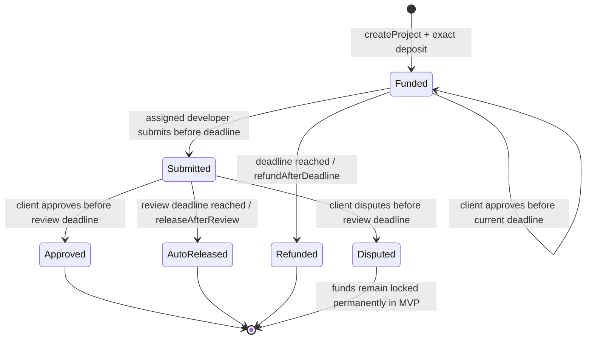

# ProofWork smart-contract architecture - MVP

## Status and scope

**Final design proposal for the hackathon MVP; no Solidity implementation or
final ABI is included.** This document reviews `PROJECT_PLAN.md` and the
earlier interface sketch. It replaces that sketch as the architecture to
implement after team sign-off.

The contract supports one native-MON escrow per website project. It holds
funds, enforces deadlines, and records the client/developer decisions. It does
not inspect websites, validate AI reports, decide disputes, or depend on the
Flask backend. Project requirements and inspection reports remain off-chain;
the contract may store a hash of the agreed project details.

## Recommendation on the proposed simplifications

### 1. Remove `acceptProject()` and `InProgress`: accept for MVP

This is a reasonable hackathon simplification. Project creation already
assigns the developer and locks the deposit atomically. Treat that as the
client's binding instruction to fund the assigned developer's work; the
developer may begin immediately. The project remains `Funded` until the
developer submits a website.

This does not let an unrelated address submit, extend, or receive the
developer's funds: those operations still require the assigned developer.
It does remove on-chain proof that the developer saw or accepted the project.
If the developer never starts, or the client enters the wrong developer
address, the client cannot cancel after funding and must wait until the
deadline to reclaim the funds. A client cancellation function would be unsafe
without an acceptance/work-start signal because it could revoke escrow after
the developer had begun work. Display this tradeoff in the UI and verify the
developer address before funding.

The deadline starts at project creation, not at a later acceptance. The
developer can request an extension before that deadline under the normal
client-approval rules.

### 2. Defer dispute settlement: accept for the testnet demo, with a warning

On dispute, the contract enters `Disputed` and leaves the escrow locked. The
MVP has no settlement, arbitration, timeout payout, admin recovery, or other
exit from that state. This is the simplest implementation consistent with
"no arbitration" and prevents either party or AI from unilaterally taking the
disputed funds.

The consequence is permanent lock: even a mistaken or bad-faith dispute can
make the funds inaccessible forever. This is a deliberate demo limitation,
not an acceptable production funds policy. Clearly warn users and use testnet
funds only. A future version must add an agreed mutual-settlement path or a
neutral resolution policy before handling meaningful value.

## Final state diagram

An extension request is pending project data; it does not introduce a
different project state. The state remains `Funded`.

`Created` is not a persisted state because creation and funding are atomic.
`InProgress` is removed because work may begin as soon as the project is
funded. `Expired` is not needed: reaching the deadline enables one direct
transition to `Refunded`. An extension request is not a project state.

## Final status enum

Recommended statuses:

1. `None` — default mapping value; the project ID does not exist.
2. `Funded` — the project was created and fully funded; work and extensions
   are pending; the developer may begin immediately.
3. `Submitted` — the developer submitted the website URL; client review is
   pending.
4. `Approved` — the client approved; the developer's claimable balance was
   credited.
5. `AutoReleased` — the review deadline passed without client action; the
   developer's claimable balance was credited.
6. `Disputed` — the client disputed; escrow is locked with no MVP exit.
7. `Refunded` — the client's claimable balance was credited after the
   pre-submission deadline.

`Approved`, `AutoReleased`, `Disputed`, and `Refunded` are terminal. Keep
`Approved` separate from `AutoReleased` so a timeout is never represented as
an explicit client decision.

## Final project struct design

Conceptual fields, not Solidity code:

| Field | Type | Purpose |
|---|---|---|
| `client` | address | Client and source of project funding |
| `developer` | address | Fixed developer assigned at creation |
| `escrowAmount` | uint256 | Full native-MON deposit, in wei |
| `state` | enum | Lifecycle state; starts at `Funded` |
| `createdAt` | uint256 timestamp | Funding/creation time |
| `deadline` | uint256 timestamp | Latest time for submission |
| `detailsHash` | bytes32 | Binds the off-chain project requirements to a hash |
| `submittedAt` | uint256 timestamp | Website submission time |
| `reviewDeadline` | uint256 timestamp | Exclusive end of the client review window |
| `websiteURL` | bounded string | Submitted URL for UI convenience; contract never fetches it |
| `requestedDeadline` | uint256 timestamp | Pending extension; zero means no request |

Use monotonically increasing IDs starting at 1, with `None` as the mapping
default for unknown IDs. Full-width timestamps avoid unsafe narrowing casts.
Store project requirements, screenshots, and reports off-chain; only store a
hash if the parties need an on-chain integrity reference. A hash does not
provide data availability or privacy. URLs and chain data are public.

Set a nonzero, immutable review period at deployment; **seven days** is the
proposed MVP default based on the plan's example. The frontend should read and
display the deployed value. Bound the URL by byte length to limit storage and
event costs.

### Escrow accounting

For safe pull payments, maintain:

- `claimable[address]`: native MON allocated to an account but not withdrawn.
- `totalEscrowed`: funds in `Funded`, `Submitted`, or `Disputed` projects.
- `totalClaimable`: sum of withdrawable balances.

The contract balance must be at least `totalEscrowed + totalClaimable`.
Creating a project increases `totalEscrowed` by exactly `msg.value`.
Approval, timeout release, or deadline refund decreases `totalEscrowed` by
exactly the project amount and increases the beneficiary's claimable balance
by the same amount. A disputed project remains in `totalEscrowed` forever in
this MVP. Withdrawal decreases `totalClaimable` by the amount sent. Forced
native transfers may make the balance larger; they do not create project
credits.

## Final function list and action rules

All time comparisons are deliberate. Acceptance is not an action. Submission,
extension requests/approval, client approval, and dispute must happen
strictly **before** their applicable cutoff. Deadline refund and timeout
release become eligible **at** their cutoff (`block.timestamp >= cutoff`).

| Function/action | Who can call | Required state | Result | Validation |
|---|---|---|---|---|
| `createProject(developer, deadline, detailsHash)` | Any client wallet | ID does not exist | `None → Funded` | Payable; `msg.value > 0`; developer is nonzero and differs from client; deadline is in the future; details hash is nonzero. `msg.value` is the escrow amount. Creation and deposit are atomic. |
| `requestExtension(projectId, requestedDeadline)` | Assigned developer | `Funded` | Remains `Funded` | Caller equals developer; before current deadline; no request is pending; requested deadline is strictly later than current deadline. Does not pause or change the current deadline. |
| `respondToExtension(projectId, approve)` | Client | `Funded`, request pending | Remains `Funded` | Caller equals client; before the current deadline. Approval replaces deadline with requested deadline; denial leaves it unchanged. Either response clears the request. |
| `submitWebsite(projectId, websiteURL)` | Assigned developer | `Funded` | `Funded → Submitted` | Caller equals assigned developer; before current deadline; URL is nonempty and within the byte-length limit. Set `submittedAt` and `reviewDeadline = submittedAt + reviewPeriod`; clear any pending extension. |
| `approveProject(projectId)` | Client | `Submitted` | `Submitted → Approved` | Caller equals client; strictly before review deadline. Credit full escrow to developer; prevent any later dispute or timeout release. |
| `disputeProject(projectId)` | Client | `Submitted` | `Submitted → Disputed` | Caller equals client; strictly before review deadline. Do not move funds. This state is terminal for the MVP. |
| `refundAfterDeadline(projectId)` | Anyone | `Funded` | `Funded → Refunded` | At or after current deadline. Credit full escrow to client. A pending extension does not block refund; only a timely client approval can change the deadline. |
| `releaseAfterReview(projectId)` | Anyone | `Submitted` | `Submitted → AutoReleased` | At or after review deadline. Credit full escrow to developer. This is a permissionless trigger, not a timer that executes itself. |
| `withdrawTo(recipient)` | Account with claimable balance | Any project state | No project-state change | Caller owns the credit; recipient is nonzero. Zero credit before external call, use a reentrancy guard, and revert on a failed transfer. Funds in a disputed project are not claimable. |
| `getProject(projectId)` | Anyone | Existing ID | No change | Read-only; unknown IDs must be clearly rejected or marked absent, not returned as a valid default project. |
| `projectCount()` and credit/accounting getters | Anyone | None | No change | Read-only. |

There is no separate deposit function: separate creation and funding would
introduce an unfunded state. There is no `acceptProject`, `cancelProject`,
settlement, arbitration, owner override, or AI/backend decision function.

### Extension policy

Only one request may be pending. If the client does not respond, the original
deadline remains. A request never pauses deadline refund eligibility. At the
old deadline, client approval is too late and refund is available. If the
developer submits before the deadline while a request is pending, submission
clears the request. The client approves the exact requested date; no automatic
extension occurs.

## Final transition table

| From | Trigger | Caller | Guard | To | Escrow effect |
|---|---|---|---|---|---|
| `None` | Create and fund | Client | Valid fields and positive `msg.value` | `Funded` | Deposit becomes escrowed |
| `Funded` | Request extension | Developer | Before deadline, no pending request | `Funded` | No change |
| `Funded` | Deny extension | Client | Request pending, before deadline | `Funded` | No change |
| `Funded` | Approve extension | Client | Request pending, before old deadline | `Funded` | No change |
| `Funded` | Submit URL | Assigned developer | Before current deadline | `Submitted` | No change; review clock starts |
| `Funded` | Missed deadline | Anyone | At/after current deadline | `Refunded` | Credit full amount to client |
| `Submitted` | Client approves | Client | Before review deadline | `Approved` | Credit full amount to developer |
| `Submitted` | Client disputes | Client | Before review deadline | `Disputed` | Remains escrowed indefinitely |
| `Submitted` | Review timeout | Anyone | At/after review deadline | `AutoReleased` | Credit full amount to developer |
| `Disputed` | Any MVP action | Anyone | No exit function exists | `Disputed` | Remains escrowed indefinitely |
| Terminal state | Any project mutation | Anyone | State is terminal | No transition | No reallocation |

## Final events

Emit an event for each state/data change. Index project ID and parties where
useful. Events help the frontend and indexer but are not a substitute for
confirmed contract state.

- `ProjectCreated(projectId, client, developer, amount, deadline, detailsHash)`
- `ExtensionRequested(projectId, developer, currentDeadline, requestedDeadline)`
- `ExtensionResponded(projectId, client, approved, resultingDeadline)`
- `WebsiteSubmitted(projectId, developer, websiteURL, submittedAt, reviewDeadline)`
- `ProjectApproved(projectId, client, developer, amount)`
- `ProjectDisputed(projectId, client, amountLocked)`
- `DeadlineRefunded(projectId, client, amount, deadline)`
- `ReviewTimedOut(projectId, developer, amount, reviewDeadline)`
- `Withdrawal(account, recipient, amount)`

Approval/refund/timeout events should accurately describe a claimable credit,
not claim the MON already reached a wallet. `Withdrawal` records a successful
transfer. Do not put reports or large unbounded data in events; consider
emitting a URL hash instead of the full public URL if size/privacy warrants it.

## Permission model

| Actor | Allowed actions |
|---|---|
| Client wallet | Create/fund; respond to extensions; approve or dispute its own project; withdraw only its own credits. No post-funding cancellation. |
| Assigned developer | Request extension and submit URL only for its assigned project; withdraw only its own credits. No on-chain acceptance action. |
| Any address / keeper | Trigger eligible deadline refunds and review-timeout credit. Beneficiary and amount are fixed by state; caller cannot redirect them. |
| Backend, AI, contract owner | No privileged authority to change state, resolve a dispute, or move project funds. |

Check project existence, exact state, and caller role on every mutating action.
A project ID is not a permission token. A permissionless timeout caller cannot
choose the recipient.

## Edge cases and product risks

| Case | Expected behavior / risk |
|---|---|
| Wrong developer address entered | Reject zero/client address, but other mistakes cannot be detected. There is no cancellation or reassignment; client waits until the deadline refund. Verify the address before funding. |
| Developer never sees or starts the project | There is no acceptance step to await. Funds remain escrowed until the deadline; anyone can then trigger the refund. |
| Client wants to cancel after funding | No cancellation. A client could otherwise revoke funds after the developer started work; without an on-chain acceptance/work-start signal the contract cannot distinguish that from an unused project. |
| Developer misses deadline | Refund is available at `timestamp >= deadline` while `Funded`. No separate `Expired` step. |
| Extension pending at deadline | It does not pause the deadline. Client cannot approve at/after the old deadline; refund is available. |
| Client ignores extension request | Original deadline remains; developer may submit before it. |
| Developer submits exactly at deadline | Rejected; refund is eligible at that timestamp. |
| Client approves/disputes exactly at review cutoff | Rejected; timeout release is eligible at `timestamp >= reviewDeadline`. |
| Client does nothing after submission | Anyone can trigger timeout credit; developer must withdraw it. The review period must be visible to the client. |
| Client disputes and parties do nothing | Funds remain locked indefinitely. No settlement, arbitration, timeout, or admin escape exists in the MVP. |
| Client disputes to block developer payment | Dispute can permanently block access even if mistaken or malicious. This is a serious, intentional no-arbitration tradeoff. |
| Website is broken/unrelated | Contract cannot judge content; client must approve or dispute before cutoff. Inaction credits developer. |
| URL is malformed or points to a private network | Contract only bounds nonempty input and never fetches it. Backend inspection must independently defend against SSRF. |
| Inspection is slow or fails | Contract time remains unchanged; backend/AI cannot pause escrow. Set a review period that leaves time to inspect. |
| Recipient rejects native MON | Pull payments keep state transitions live; credited owner may choose a compatible `withdrawTo` recipient. |
| Duplicate payout/withdrawal | Terminal state and zeroed credit before external call prevent double allocation or withdrawal. |
| Unexpected native funds sent to contract | Do not treat forced funds as deposits or credits. No owner sweep in MVP. |
| Long URL or project details | Store a details hash and cap URL bytes; keep full requirements/reports off-chain. |
| Review-period arithmetic | Require a nonzero deployment-time period and use checked addition for `reviewDeadline`. |
| Chain timeout automation | A caller must submit the refund/release transaction; time passing alone changes no state. |

## Security considerations

1. **Authorization and state guards:** Check project existence, exact state,
   caller role, and time cutoff for every state-changing call.
2. **Accounting:** Keep contract balance at least `totalEscrowed +
   totalClaimable`. Allocate each project amount exactly once. Disputed funds
   remain escrowed and are not withdrawable.
3. **Pull payments:** Do not call client/developer during project state
   transitions. Zero a caller's credit and decrement aggregate liabilities
   before the withdrawal call; use reentrancy protection and revert on failure.
4. **No double allocation:** Terminal states cannot transition again. A project
   cannot be refunded after submission, timeout-paid after dispute, or paid
   after a deadline refund.
5. **No privileged bypass:** No owner override, AI verdict, backend signature,
   admin refund, arbitrary payout, or post-deployment deadline mutation.
6. **Bounded user data:** Bound URL bytes and keep requirements/reports
   off-chain. The contract never navigates to a submitted URL.
7. **Native MON only:** Avoid ERC-20 behavior and token compatibility concerns
   in this MVP.
8. **Immutable policy:** Fix review period and any extension policy at deploy
   time. Publish configuration so the UI can verify it.
9. **Timestamp boundaries:** Use exact `<` versus `>=` rules in the tables and
   test before/at/after each cutoff.
10. **Deployment controls:** Verify compiler settings and bytecode, deploy only
    to the intended Monad testnet, verify chain ID/address, and never use real
    funds without independent review.

This is architecture, not an audit. Test all permitted and forbidden calls,
deadline boundaries, extension races, duplicate calls, failed withdrawals,
and accounting invariants. Testnet deployment does not prove security.

## Final MVP recommendation

Accept both simplifications for the hackathon:

- Remove `acceptProject()` and `InProgress`. Begin the deadline at funding;
  developer identity and submission permissions remain explicit.
- Defer settlement. Make `Disputed` terminal and locked, and clearly label the
  permanent-lock risk in the testnet demo.

The tradeoffs are meaningful: no developer acknowledgment or client
cancellation, and permanently inaccessible disputed funds. These do not
prevent a coherent testnet demonstration, but they make the design unsuitable
for real funds without a later dispute-resolution policy.

Before implementation, Developer A and Developer B should confirm the
seven-day review period, URL byte limit, off-chain metadata hash format, and
the final event/API schema. Then revise `IProofWorkEscrow.sol` and derive
contract tests from the final transition table; its current enum and methods
are the earlier skeleton, not this final design.
